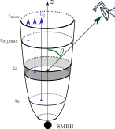

# ExtendedJet

ExtendedJet is a non-thermal, multi-zone emission model for relativistic jets.
The details of the model are presented in [Gutierrez et al. (2026)](https://ui.adsabs.harvard.edu/abs/2026arXiv261026434G/abstract).



The model is implemented in modern Fortran, compiled with Make, and run as
`./run.x params.nml`. Build products can be removed with `make clean` from
`Code/`.

## Environment

The repository uses one full Mamba environment for the Fortran model, f2py,
tests, notebooks, diagnostics, and post-processing:

```bash
mamba env create -f environment.yml
mamba activate extendedjet
```

The environment includes JupyterLab, Astropy, pandas, and Gnuplot. Plots use
Matplotlib text by default, so a separate LaTeX installation is not required.
For publication-style plots, set `text.usetex` to `True` in
`postprocessing/plot_utils.py` when a working LaTeX installation is available.

The documented workflow is tested on Linux with GNU Fortran, OpenMP, Make,
Python, and f2py.

## Layout

- `Code/`: Fortran sources, Makefile, and generated build files.
- `configs/`: runtime namelists.
- `diagnostics/`: diagnostic notebooks and plotting scripts.
- `figures/`: repository figures and diagrams.
- `postprocessing/`: map notebook and Python post-processing utilities.
- `tests/`: unit tests, frozen-output regression, and f2py consistency checks.
- `fitting/`: reusable source-fitting model, likelihood, sampler, plotting, and CLI.
- `validation/`: electron-distribution and characteristics validation, and grid convergence.
- `output/`: generated reference-model outputs.
- `tests/output/`, `validation/output/`: disposable test and validation outputs.

## Quick Start

From the repository root, build the executable and the Python wrapper, then
run the pass/fail tests:

```bash
make -C Code
make -C Code f2py
make -C Code test
```

`make -C Code test` and `make -C Code validate` also build the f2py module
when they are run independently.

Run the reduced configuration with:

```bash
(cd Code && OMP_NUM_THREADS=1 ./run.x ../configs/test.nml)
```

The reduced run uses `Ns=100` and `numbins=250` and writes disposable output
to `tests/output/`.

Run the production M87 configuration with:

```bash
(cd Code && OMP_NUM_THREADS=1 ./run.x ../configs/m87_reference.nml)
```

The reference run uses `Ns=700` and `numbins=1100` and writes output to
`output/`. Its configuration enables output sorting and loss-file generation.

## Post-Processing

Parameter exploration uses the f2py wrapper:

```bash
make -C Code f2py
OMP_NUM_THREADS=1 python diagnostics/explore_parameters.py
```

Plots are written to `diagnostics/parameter_exploration/` by default. Use
`--sweep NAME` to run one sweep or `--output-dir PATH` to change the output
directory. The sweeps run sequentially because the Fortran modules retain
mutable state.

The map utility creates jet-only, beam-convolved intensity maps at two
frequencies and a spectral-index map. The default is 22 and 43 GHz with the
1.2 and 0.31 mas circular beams used for M87:

```bash
make -C Code f2py
python postprocessing/Fmap.py
```

The PDFs are written to `output/figures/`: `Map_I_22GHz.pdf`,
`Map_I_43GHz.pdf`, and `Map_spix.pdf`. The output root is read from the
selected namelist and can be overridden with `--outdir`. Frequencies and beams
are positional:

```bash
python postprocessing/Fmap.py --frequencies 22 43 --beams 1.2 0.31
python postprocessing/Fmap.py --beams 1.2,1.0 0.31,0.25
```

A scalar beam is circular; `major,minor` is an elliptical FWHM in mas. The
spectral-index map uses both frequencies convolved to the lower-frequency
beam. Use `--jet-pa` to change the sky position angle; the default is -72
degrees. Intensity maps use a plotting dynamic range of `1e5` by default, from
the map maximum down to `S_max / dynamic_range`. The same ratio controls the
spectral-index mask; use `--dynamic-range VALUE` to change it, with values
greater than 3.

## Tests and Validation

Run the pass/fail tests with:

```bash
make -C Code test
```

This runs numerical unit tests, a reduced Fortran regression, the f2py
consistency check, and the mJy/beam map-convolution checks. The regression runs
`configs/test.nml` in a temporary output directory and compares jet and
counter-jet fluxes with the frozen references in `tests/reference/test/` over
the radio band.

The reference M87 map flux can be checked separately against the Fortran
`dflux_dz` calculation with:

```bash
make -C Code validate-map
```

This requires the reference model outputs and accepts differences up to 1% at
22 and 43 GHz. Normal `Fmap.py` execution does not perform this extra check.

A minimal Bilby/emcee sampling validation is available separately:

```bash
make -C Code validate-mcmc
```

It uses the M87 namelist with a deterministic synthetic truth, fits `a_inj` (`a_e`) and
`geomIndex_out` (`w`), and generates deterministic synthetic fluxes at 3, 10,
22, 43, and 86 GHz and at 30, 100, and 200 `R_g`. The default reduced run uses
40 jet segments, 100 transport bins, 8 walkers, and 200 steps. It
writes `validation/output/mcmc_validation/SED_m87_reference.pdf` and
`corner_m87_reference.pdf`.
The SED figure uses a dense 1--1000 GHz model grid, fixed y-limits of 0.01--10
Jy, 68% posterior-predictive bands, and a separate `Delta S/S` residual panel. The script reports the time
spent in sampler model evaluations and posterior-predictive plotting models.
The fitting and plotting path evaluates the aperture SED directly at the
requested frequencies; it does not interpolate the fixed-grid `run.x` tables.
When luminosity is fitted, add `log_Lj` to the flux JSON `fit_parameters` list;
this samples `log10(Lj)` uniformly from 40 to 43 and converts it to physical
`Lj` internally.
The validation uses fixed reduced settings so implementation changes are
compared under the same conditions.

The reusable source-fitting workflow uses the same likelihood, sampler, and
plotting code:

```bash
python fitting/fit_source.py \
  --nml configs/m87_reference.nml \
  --fluxes configs/m87_reference_fluxes.json \
  --outdir output/m87_reference \
  --mode overwrite
```

The flux file contains top-level `fit_parameters`, `frequencies_GHz`,
`apertures_Rg`, `fluxes_mJy`, and `errors_mJy` arrays. The flux matrix is indexed as
`[frequency][aperture]`. Use JSON `null` when no measurement exists at a
frequency/aperture pair. Do not use zero or `NaN`: zero is not a valid measured
flux for this likelihood, and `NaN` is not standard JSON. Missing fluxes must
have corresponding `null` errors. Upper and lower limits are not supported yet.

Parameters not listed in `fit_parameters` remain fixed at their values from
the namelist. Universal prior ranges are defined by the fitting code, so they
do not need to be repeated in the source files. The fitter requires
`--mode overwrite` or `--mode resume`; this prevents accidental chain deletion.
The fitting adapter always uses circular projected aperture weighting, regardless
of the namelist `aperture_area` setting. The M87 example uses aperture assignments
inferred from the supplied EHT multi-wavelength plotting workflow; these should
be reviewed before treating the file as a final scientific data product.

The f2py consistency check can also be run directly:

```bash
make -C Code test-f2py
```

It checks that `syn_model` reproduces the total flux from `run.x` to better
than 1% over `1e9`--`1e20` Hz. Use the test script's `--nml` option to test a
different namelist.

The physics validation is run with:

```bash
make -C Code validate
```

This validates the electron-distribution transport kernel against analytic
solutions, checks particle-number conservation and convergence in `numbins`,
and compares a full run with a characteristics solution. Validation plots are
written to `validation/output/ne_validation/`.

For a debug build and test run:

```bash
make -C Code clean
make -C Code DEBUG=Y test
```

For grid-convergence studies, see `validation/grid_convergence.py`. For
profiling symbols, use `make -C Code clean && make -C Code PROFILE=Y`; this
does not itself generate a `gprof` profile.

## Model Scope and Configuration

The current configuration uses only the cosmic microwave background as its
external photon field. The generic inverse-Compton kernel can receive other
black-body-like fields, but no stellar or other external field is configured.

Important `&run` switches include:

- `sort_outputs`: generate files ordered for post-processing.
- `grav_redshift`: include Schwarzschild gravitational redshift in the synchrotron fluxes.
- `aperture_area`: weight aperture fluxes by the projected cross-section of each segment.
- `NE_calc`, `Np_calc`: calculate electron or proton distributions.
- `radsyn_calc`, `radpsyn_calc`, `radic_calc`: enable the corresponding radiation calculations.
- `JET_`, `CJ_`: calculate the jet and counter-jet contributions.

The production grid was selected from full-model convergence tests using a
mixed tolerance of 3% for aperture fluxes and 1% for total flux. The compile-
time electron output grid is `nIn=150`. The selected `Ns=700` grid remains
within the production `numdt=100000` transport-history limit; finer runs may
exceed that limit and require an isolated build with a larger value.

The standard validation commands are:

```bash
make -C Code test validate
(cd Code && OMP_NUM_THREADS=1 ./run.x ../configs/m87_reference.nml)
```

The current reference run reproduces these flux-file hashes on the reference
machine:

```text
Flux_e.dat:   cbe67602fd6beddc4c12fb4a5855e0bfd75d78e99627641ab529b5cd75063624
FluxCJ_e.dat: fb17bbeb24fc8a87eab1741d90c95685bee36cf3ab9d870ae99a03937bbe279d
```

Exact hashes and runtimes depend on the compiler, hardware, build flags, and
thread count. Production builds use `-march=native` and `-ffast-math`, so they
should not be treated as bitwise reproducible across different machines.

The `SEDssc_data` routine is retained as an incomplete future path; its
unused-argument warnings are expected.

## Citing

If you use this code, please cite:

Gutierrez, E. M., del Palacio, S., & Mazzei, T. T. (2026), *The accretion
flow and jet of M87: broadband modelling across spatial scales*,
[arXiv:2610.26434](https://arxiv.org/abs/2610.26434),
[ADS](https://ui.adsabs.harvard.edu/abs/2026arXiv261026434G/abstract).

```bibtex
@ARTICLE{2026arXiv261026434G,
       author = {{Gutierrez}, E.~M. and {del Palacio}, S. and {Mazzei}, T.~T.},
        title = "{The accretion flow and jet of M87: broadband modelling across spatial scales}",
      journal = {arXiv e-prints},
         year = 2026,
        month = oct,
          eid = {arXiv:2610.26434},
archivePrefix = {arXiv},
       eprint = {2610.26434},
 primaryClass = {astro-ph.HE},
       adsurl = {https://ui.adsabs.harvard.edu/abs/2026arXiv261026434G}
}
```

## License

This project is distributed under the GNU General Public License v3. See
[LICENSE](LICENSE).
